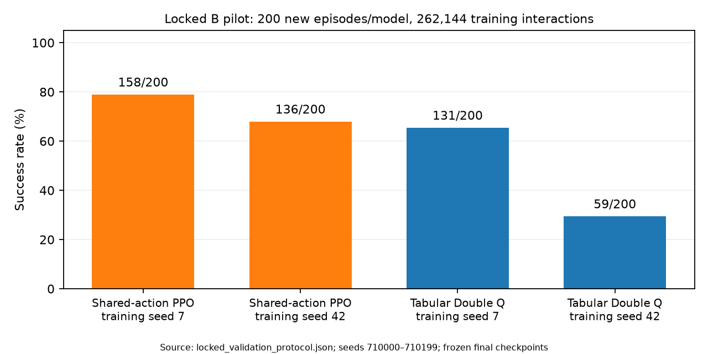

# Further development investigation

**Protocol correction following the user's reminder:** Part 2 must match the
original Part 1 prediction sheet: ordinary tabular Q-learning versus PPO, with
coarser/finer versions of the same underlying game information. The Double Q
and replay packages below are exploratory deviations, not the ordinary
single-table, one-update-per-move Q-learning comparison described there.
Their 29.5%/65.5% locked success rates must not be relabelled as that baseline's
results or promoted into the main A–D comparison. The ordinary-Q replacement
and separate corrected-feature rerun are documented in [SINGLE_Q.md](SINGLE_Q.md).
Preserve the predictions and the full
Double Q record; do not rewrite either to conceal this distinction.

This follows the user's request to continue after the unsuccessful short pilot.
It uses **Gymnasium**, stochastic setting B, the same five native actions,
score-increment rewards, 2,000-point success threshold and 1,000-decision horizon.
There is no reward shaping, teacher policy, demonstration dataset, forced action
filter or rollout of future simulator states. The held-out D layout and original
900000-series final evaluation seeds are not used. This is exploratory follow-up
after the previous results were inspected, followed by separately locked B-only
validation. It is not a replacement for a complete controlled A–D experiment.

The final exploratory candidates both use **262,144 training interactions**, with frozen
final checkpoints rather than a different selected peak for each training seed.
On the locked, previously unused 710000–710199 episode seeds:

| Final candidate | Training seed | Successes / episodes | Success rate | Mean raw game points |
|---|---:|---:|---:|---:|
| Food-relative tabular Double Q | 42 | 59 / 200 | 29.5% | 1,581.05 |
| Food-relative tabular Double Q | 7 | 131 / 200 | 65.5% | 1,880.25 |
| Shared-action PPO | 42 | 136 / 200 | 68.0% | 1,999.95 |
| Shared-action PPO | 7 | 158 / 200 | 79.0% | 1,971.35 |

All four model hashes, seed lists, rewards, episode horizons and disabled
learning were verified. Q improves substantially but still varies much more
between these two training seeds. PPO has the stronger result in this pilot.
This comparison is between the complete feature/algorithm/budget packages;
it does not isolate the effects of geometry, replay or architecture.
Sources: `locked_validation_protocol.json`, `locked_validation_summary.csv`
and `locked_validation_checks.json` under the experiment output directory.
Mean lengths by outcome are included in that summary. The validation was not
used for further configuration or checkpoint selection.



## Concrete implementation findings

The original feature geometry contains errors: pellet columns 9–17 have an extra
four-pixel horizontal offset, and several cells in both manually copied layout
masks differ from the upstream extractor. The first local pilot inherited these
errors. `maze_geometry.json` now contains automatically extracted lookup data
with the source URL and SHA-256, avoiding another manual transcription.

`navigation_features.py` retains the original information with corrected object
centres and adds current corridor, food-path, ghost-proximity and motion features
(45 values). Nearest-path features describe the observed map/food state. They do
not prescribe the selected action. The training graph has 154 connected nodes.
The original masks differ in 8 cells for layout 0 and 28 for layout 1.
Real movement alignment was checked over 82,586 moving observations: 98.7% lie
exactly on a graph corridor. This remains an approximate food-lattice geometry,
especially around startup, death animations, tunnels and ghost-house paths. It
is **not** a certified legal-action mask, and no actions are masked here.

`validate_navigation.py` checked 1,405 identical Gymnasium decisions over three
episodes: original and rich wrappers produced identical RAM, rewards, terminal
flags, scores and success outcomes. All rich observations satisfy their space.
Original Part 2 source files and predictions are checked against the recorded
protocol hashes by `exploration_summary.py`; they have not been rewritten.

The inherited power feature still caps RAM 116 at 63. The successful replay
shows values above 63 after ghosts are eaten, so this should be described as a
capped power-related signal, not a validated precise remaining-time estimate.
Its bit-level meaning needs a separate diagnostic before a final timer claim.
Changing its decoder would require new training and compatible checkpoints.

## Configurations and controls

`reference_ppo.py` uses Stable Baselines3 2.9.2 PPO, four Gymnasium environments,
separate two-layer 64-unit actor/value networks, LR 0.0003, gamma 0.995, GAE 0.95,
512 steps/environment, minibatches 256, four epochs, clip 0.2, entropy 0.01 and
target KL 0.02. Rewards are scaled by 1/100 internally; reported scores are raw
game points. Base observations are compared with corrected/rich observations.
This reference also changes hyperparameters and architecture from the original
custom PPO, so its gain cannot be attributed solely to the implementation switch.

`navigation_q.py` includes a compact relative-state one-step Q control and a
phase-aware Watkins Q(lambda) candidate: alpha 0.15, gamma 0.99, lambda 0.8,
replacing traces, epsilon decreasing linearly from 1 to 0.05 over 80% of the
budget. Phase bins describe displacement from the nearest graph node. The
off-policy max-Q target and table are retained. This is a Q-learning extension,
not exactly the original one-step update. Traces are cut for nongreedy behavior
actions. Noop and wall-facing actions remain available.

Additional exploratory packages are explicitly separate: `canonical_q.py`
shares table entries under a food-relative rotation (gamma 0.95), and
`shared_policy.py` gives PPO learned action scores with shared directional
weights. These are not one-factor controls for the trace candidate/reference PPO.

Most runs have a **524,288-interaction maximum**, eight checkpoints spaced by
65,536, and 20 development episodes/checkpoint (670000–670019). Smaller base PPO,
canonical Q and shared-actor investigations use 262,144. Greedy and sampled PPO
are logged separately; Q uses greedy actions with seeded random ties. Existing
controls are not silently rerun with the larger budget. This exploratory search
has unequal tuning effort and cannot serve as the final controlled A–D study.

## Confirmed observations

At training seed 42, corrected/rich PPO's 327,680-step checkpoint reached the
goal in 20/20 development episodes. A subsequent frozen-policy check on **50 new
development episodes** (680000–680049) reached it in **50/50**, averaging
**2,500.4 points**. Original PPO seed 42 on those same 50 seeds scored 259.8
points and 0/50 successes. The baseline model had 65,536 training interactions;
the improvement package also uses more training, so this is not an equal-budget
algorithm-only comparison.

Independent replay checked every score increment against the native game's
BCD score registers and inspected the RGB screen. The 3,390-point episode earns
200-, 400-, 800- and 1,600-point ghost bonuses after a power pellet; the extra
score is real game reward, not a reporting or pellet-unit error. Only 330
decisions are needed in that episode. This demonstrates a successful strategy
on the training layout, not completion of the maze or robust transfer.

The phase/trace Q candidate reached 8/20 successes and 1,642 mean points at
458,752 interactions. On the separate 50-seed development set, its frozen table
achieved **16/50 (32%) and 1,516.8 mean points**, versus **0/50 and 626.4** for
original Q seed 42. This is a substantial observed improvement for this trained
seed. It does not establish that the extra features, traces or larger budget
individually cause the gain.

| Frozen seed-42 policy | Mean raw points | Successes / new development episodes |
|---|---:|---:|
| Original Q, 65,536 interactions | 626.4 | 0 / 50 |
| Phase/trace Q, checkpoint 458,752 | 1,516.8 | 16 / 50 |
| Original PPO greedy, 65,536 interactions | 259.8 | 0 / 50 |
| Corrected/rich reference PPO, checkpoint 327,680 | 2,500.4 | 50 / 50 |

These rows use the same 680000–680049 environment seeds. The new models are
development-selected intermediate checkpoints, not the final models at a common
fixed training budget. Episode counts are not numbers of training replications.

**More training is not consistently better.** PPO seed 42 fell from 20/20 at
327,680 to 0/20 at 393,216; trace Q fell from 8/20 at 458,752 to 3/20 at
524,288. The successful intermediate checkpoint is preserved. A future stopping
or checkpoint-selection rule must be specified and evaluated separately. These
curves do not justify blindly increasing the budget or reporting only a peak.

Repeating the phase/trace Q package at seed 7 did **not** confirm its selected
10% selection success: it achieved **0/50** and 1,097.8 mean points on the new
development set, against original Q's **1/50** and 783.0. Thus the strong Q gain
is seed-dependent and the trace package is not ready to be called reliable.

The shared-actor PPO package has a stronger replication result. At the **final
262,144-interaction checkpoint**, seed 42 scored **35/50 (70%)**, and seed 7
scored **37/50 (74%)** on the same new development seeds. Mean points were
1,995.2 and 1,951.8. Both original PPO seeds achieved 0/50. These are two actual
training replications, not 100 independent trained agents. The packages also
differ from the baseline in architecture, features, update settings and budget.

A bounded Q follow-up tested `replay_double_q.py`: tabular Double
Q-learning, one online plus four replay updates per actual interaction, a
50,000-observed-transition buffer, alpha 0.15 divided by the square root of
1 + per-table/state/action updates / 100, and gamma 0.99. Its state adds actual
movement, nearest-food distance bins and 2x2 coarse position to distinguish
aliased waits/approaches/empty corridors. It uses 262,144 interactions at seeds
42 and 7. This is a package feasibility test, not attribution of any gain to
replay alone. The buffer contains no simulated or teacher-provided transitions.
Both learned tables are frozen and fingerprinted during evaluation.

At the final 262,144-step checkpoints this package achieved 6/50 (12%) and
4/50 (8%) on the new development episodes, averaging 1,265.4 and 1,214.0 points.
This improves the weak baseline but remains insufficient for reliable success.
Adding epsilon 0.05 to the earlier frozen trace-Q policies also failed to solve
the problem: 13/50 and 2/50, versus greedy 16/50 and 0/50. It is a different
evaluation policy, not new learning.

`goal_replay_q.py` is the subsequent smaller-table investigation. It learns the
same Double Q/replay updates in a food-relative coordinate frame, with all five
actions still possible. Nearby food's observed offset determines the reference
direction; farther away the current food-path feature does. This avoids an
arbitrary reference direction when adjacent graph edges tie because food lies
at the current nearest node. Initial Q-values are equal for every action; the
rotation itself does not prescribe movement. The state retains corridor and
threat masks, power status, food-proximity bins, actual motion and proximity to
the nearest graph node. This is a different representation package, not a
one-factor mechanism test.

The short 131,072-interaction test uses seeds 42/7, followed by a fresh pair at
262,144 to match the shared PPO candidate's budget. At 65,536 interactions the
short runs have about 1,600–1,700 states instead of the previous Double Q's
6,300–6,900, with 1,399/1,440.5 mean development points. Separate frozen-policy
confirmation at the short budget produced 16/50 and 1/50 successes: this was
still too seed-dependent. The fresh pair with the longer exploration/training
schedule performed better at the **final 262,144 checkpoint**: **17/50 (34%) and
22/50 (44%)**, with **1,660.8/1,770.2** mean points. Both final models have 2,455
table states. Their common intermediate checkpoint (196,608) scored 16/50 and
20/50, so the final new-development gain does not depend on choosing a different
best checkpoint for each seed. Both estimates remain tabular; this is not DQN.

An additional `power_goal_q.py` short test retains direction toward power pills
when unpowered or ghosts when powered, coarsening information already supplied
to PPO. At 131,072 interactions its selection success was 3/20 and 5/20,
against the short food-relative package's 6/20 and 3/20. It shows no consistent
pooled improvement at this budget and is not adopted. This does not prove the
bonus information is irrelevant: adding it also increases table size.

## Locked pilot validation

After the exploratory comparisons, four final models were frozen by SHA-256
before opening **710000–710199**, a new 200-episode seed set per model:
food-relative Double Q and shared-action PPO, training seeds 42 and 7, all at
exactly **262,144 training interactions**. The frozen registry is
`locked_validation_protocol.json`. No intermediate checkpoint replaces them
after this validation, and these seeds are not used for further tuning.

This locks the pilot's conditional validation, not a new complete Assignment 4
benchmark. The earlier exploratory search had unequal effort and inspected
several configurations. Only B and two training seeds are covered. The required
A/C/D study and Part 3's five-seed mechanism experiments remain separate work.
The four frozen checks are complete: 800 episodes in total. Their results are
the table at the start of this record; the earlier 20/50-episode measurements
below describe development and historical diagnostics, not competing final tests.

All development curves, failed variants and final checkpoints are retained,
including the plain relative Q control that did not improve. The single rich
PPO 100% checkpoint is useful as a demonstration, but is not the strongest
evidence for stability across training seeds; the two shared-actor runs are.

## Evidence and reproduction

Local numerical records live in `results/assignment4/further_exploration/`:

- Run directories: protocols, checkpoint models, training logs, raw development
  episode CSVs, progress tables and completed-run summaries.
- `confirmation/`: frozen-policy checks on the separate 680000-series seeds.
- `score_replay/`: native-score verification, full decision traces and RGB frames.
- `geometry_audit/`: upstream source, movement alignment, mask differences and
  Gymnasium equivalence verification.
- `selected_by_development.csv`: exploratory checkpoint choices, success then
  mean score then earliest checkpoint, explicitly selected using development.
- `registered_sources_unchanged.json`: protected source/prediction hash checks.
- `locked_validation_summary.csv` and `locked_validation_checks.json`: final
  candidate measurements and verification for all 800 locked episodes.
- `locked_evaluation_sources/`: inference-source snapshots used by validation.

Primary method references: [Double Q-learning, van Hasselt (2010)](https://proceedings.neurips.cc/paper_files/paper/2010/hash/091d584fced301b442654dd8c23b3fc9-Abstract.html)
and [Stable Baselines3 custom policies](https://stable-baselines3.readthedocs.io/en/master/guide/custom_policy.html).

The canonical-Q initial run's `unseen_fraction` field is incorrectly 1.0 because
the evaluator looked up a rotated-state wrapper instead of its canonical table
key. This is a diagnostic metadata bug, not a training/action bug. It is fixed
for new runs; do not interpret that old field as evidence of unseen states.

Frozen NumPy PPO inference is checked against Torch log probabilities to 1e-5
through the first confirmation episode. Greedy choices match the saved actor;
NumPy stochastic confirmation uses its own seeded categorical generator rather
than pretending to reproduce Torch's samples. Both table contents and model
files are checked unchanged during Q confirmation. Training wall times were
measured with concurrent jobs; they are not comparable isolated timing benchmarks.

From the repository root, install root dependencies plus
`notebooks/assignment4/pilot/requirements.txt`. Then, for example:

```powershell
python notebooks/assignment4/pilot/validate_navigation.py
python notebooks/assignment4/pilot/reference_ppo.py --observation rich --policy shared --budget 262144 --seed 7 --fast-eval
python notebooks/assignment4/pilot/navigation_q.py --representation goal_replay --budget 262144 --seed 7
python notebooks/assignment4/pilot/exploration_summary.py
```

Completed run directories are protected from overwrite; incomplete directories
are also protected, so use a fresh `--tag` for a new attempt. Exact source
snapshots are saved. The first base/rich reference runs preceded that addition;
their initial runner has subsequently been recovered by reversing the recorded
CLI/evaluation changes and requiring an **exact match to the pre-run SHA-256**.
See `source_recovery.json`. The first rich feature snapshot likewise matches
the earlier Gymnasium audit's hash. Later changes add CLI options and faster
optional evaluation, not changes to the already-measured training rules.

The shared-PPO seed-7 confirmations also have native RGB demonstrations at
approximately 4x real-time under `score_replay/`. A success (seed 680002,
2,080 points/319 decisions) and a failure (680027, 1,420 points/889 decisions)
were selected by the median episode length within each outcome group. Their
full traces match the game's score registers and the confirmation CSV.
`demo_selection.json` documents this selection. These two examples do not
constitute the required ten-episode Part 4 analysis.

The registered main report remains a historical baseline. This investigation
provides 200 locked validation episodes for each of four B-only pilot models.
It does not satisfy Part 3's five-seed requirement or the complete new A–D
comparison, including evaluation in A/C/D. Do not substitute the earlier
development scores for those requirements or edit the original predictions
after observing them.
