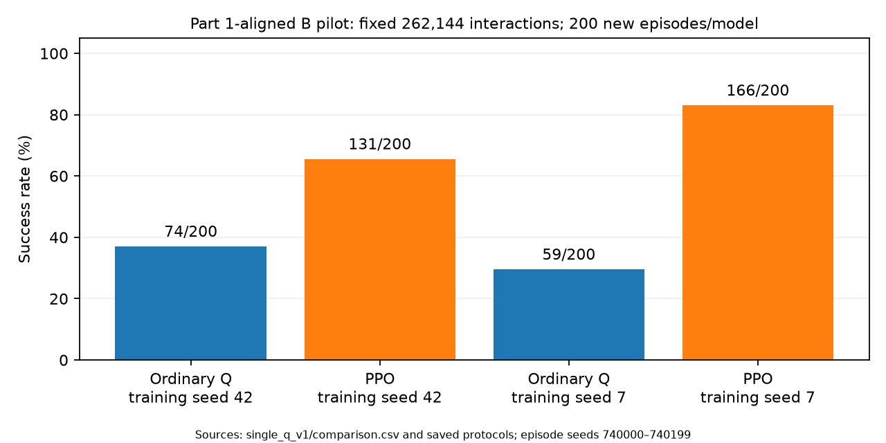

# Ordinary Q-learning matching Part 1

The active replacement for the improved Q candidate is `tabular_q.TabularQ`.
The original prediction sheet remains unchanged. Double Q/replay results in
`FURTHER_EXPLORATION.md` belong to archived exploratory variants and must not
be reported as results for this method.

The rerun is complete. These are frozen **final** models after 262,144 training
interactions, evaluated on the same 200 new episode seeds per model:

| Method | Training seed | Successes / episodes | Success rate | Mean raw points |
|---|---:|---:|---:|---:|
| Ordinary single-table Q-learning | 42 | 74 / 200 | 37.0% | 1,648.35 |
| Ordinary single-table Q-learning | 7 | 59 / 200 | 29.5% | 1,646.00 |
| Unchanged PPO | 42 | 131 / 200 | 65.5% | 1,987.30 |
| Unchanged PPO | 7 | 166 / 200 | 83.0% | 2,000.15 |

The Q models each performed exactly 262,144 learning updates. Model-file
inspection confirms `TabularQ` instances with one table, no second estimate,
replay memory or traces. PPO hashes match the earlier saved PPO models. This
is the current ordinary-Q/PPO B-only comparison; the Double Q figures are not
substituted for it. Two training seeds give limited evidence about variability.



## Method

- One Q-table with five values per compact state.
- Exactly one ordinary off-policy Bellman update after each real Gymnasium step:
  `Q(s,a) += alpha * (reward/100 + gamma * max(Q(next_state)) - Q(s,a))`.
  A terminal transition omits the next-state term.
- Alpha 0.15, gamma 0.99. Epsilon decreases linearly from 1 to 0.05 over the
  first 80% of training; evaluation uses greedy actions with seeded uniform ties.
- No replay, second table, eligibility traces or neural Q function.
- The corrected 45-value observation is the same underlying information used
  by the PPO candidate. Q discretises local position context, nearby ghost
  threats, food direction/proximity, motion and power status. Food-relative
  coordinates share entries between rotated local situations. All five initial
  Q-values are equal and all five native task actions remain available.
- The episode still requires at least 2,000 raw game points before all lives
  are lost or 1,000 decisions pass. Frameskip 4 and sticky probability 0.25
  retain setting B. Agents use Gymnasium `reset` and `step`.

The PPO learner is unchanged SB3 clipped PPO with a shared action scorer and a
separate value network. Its actual shared actor has two 32-unit hidden layers
per action (18 input values per action); the value network has two 64-unit
layers over the full 45-value observation. The archived reference runner's
generic `policy_net=[64,64]` describes its default MLP, not this custom actor.
The custom actor is defined in `shared_policy.py`; the trained PPO weights are
preserved and hash-checked during the new paired evaluation.

## Validation

`validate_tabular_q.py` checks a numerical nonterminal target, exclusion of
bootstrapping at terminal states, the bijective native-action mapping and
read-only action selection. The trainer additionally asserts that its update
counter equals the real interaction counter at every checkpoint.

The rerun fixes the budget at 262,144 interactions for training seeds 42 and 7.
Development curves use seeds 730000–730019; the final full-budget models are
evaluated without updates on the predeclared 740000–740199 seed set (200 each).
No intermediate checkpoint replaces the final model. The unchanged PPO models
are evaluated on the identical 200 episode seeds, so this is a paired B-only
comparison. This is separate from the earlier locked Double Q validation.

Results, source snapshots, protocols and per-episode CSVs are stored locally
under `results/assignment4/single_q_v1/`. `comparison.csv` contains the measured
ordinary-Q/PPO results once all four evaluations complete. `validation.json`
records the update counts, frozen models, common seeds and prediction hash
checks. PPO raw episode records are under the matching
`further_exploration/confirmation/aligned_ppo_*_740000/` directories.
Training wall times were collected under concurrent pilot jobs and should not
be presented as isolated computation-time comparisons.

From the repository root, with the root and pilot dependencies installed:

```powershell
python notebooks/assignment4/pilot/validate_tabular_q.py
python notebooks/assignment4/pilot/single_q_experiment.py --seed 42
python notebooks/assignment4/pilot/single_q_experiment.py --seed 7
python notebooks/assignment4/pilot/summarize_single_q.py
```

The unchanged PPO evaluation uses `confirm_candidate.py --kind sb3` with its
saved `shared_rich_{seed}_262144/checkpoint_262144.zip`, label
`aligned_ppo_{seed}_740000`, `--seed-start 740000 --episodes 200`. Existing
completed evidence is preserved; incomplete run directories cannot be silently
overwritten.

This change aligns the learning method with Part 1. The inherited power-related
signal is still capped and must not be described as a verified precise remaining
power-time estimate. The report's original A–D results remain a historical
baseline: this B-only rerun does not complete the new A/C/D evaluation, five-seed
Part 3 experiments or the human review. Do not modify the original predictions
or relabel the old Double Q rates to fill those gaps.
