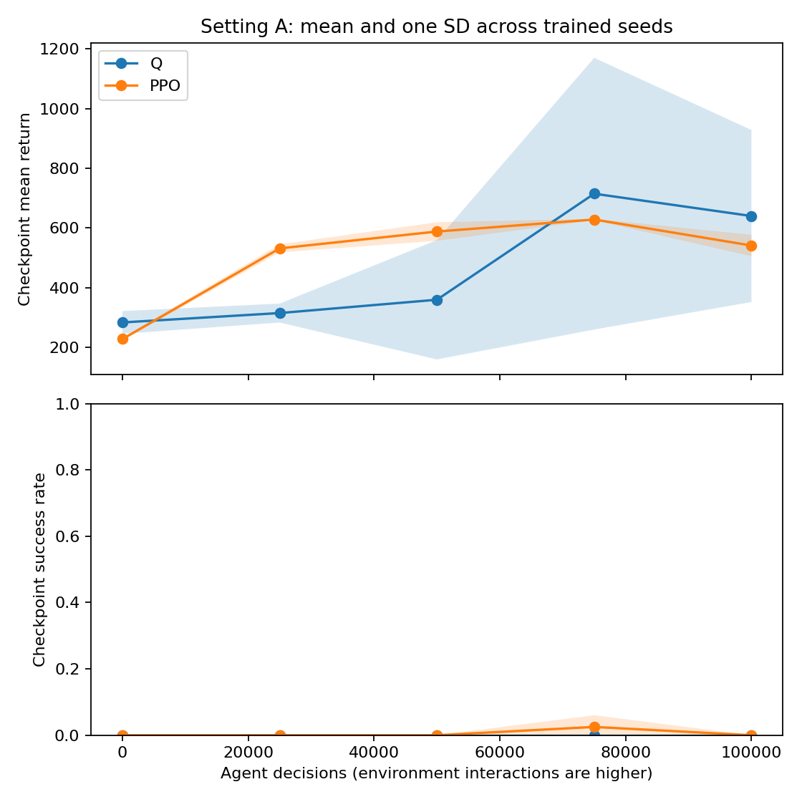
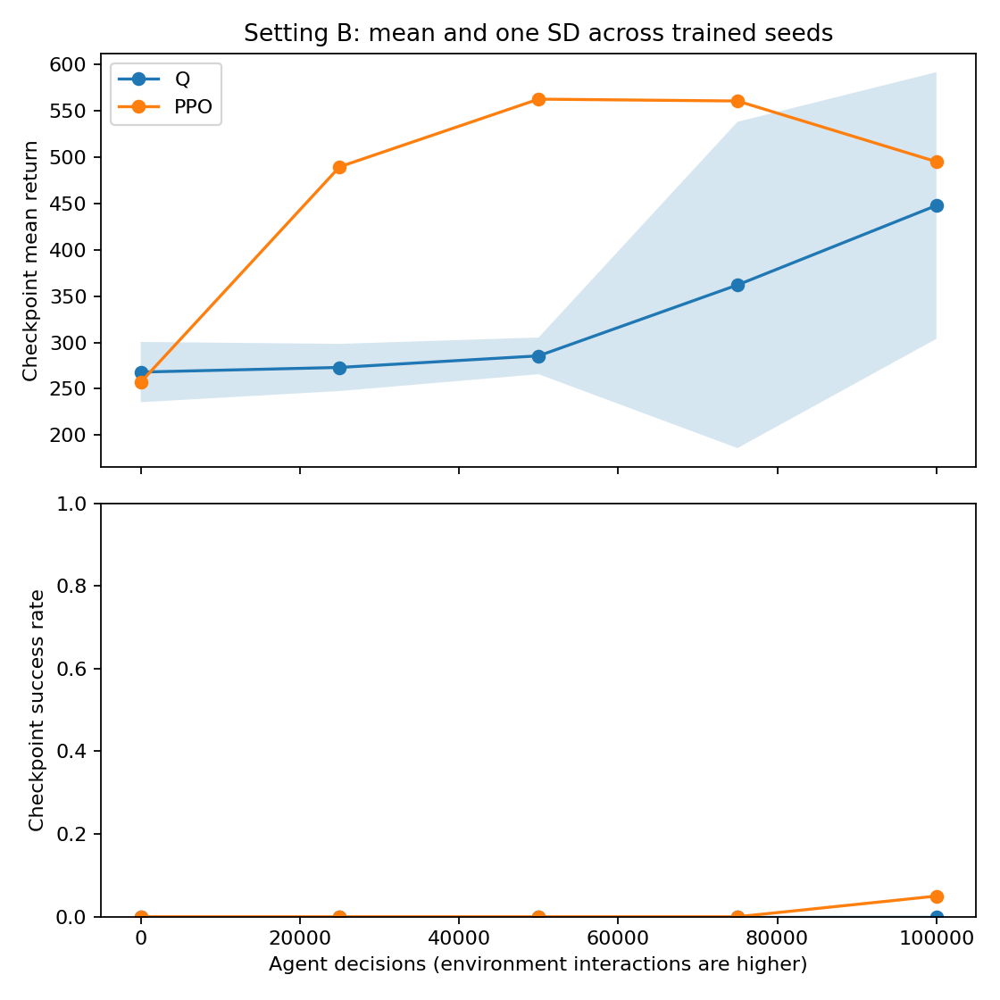
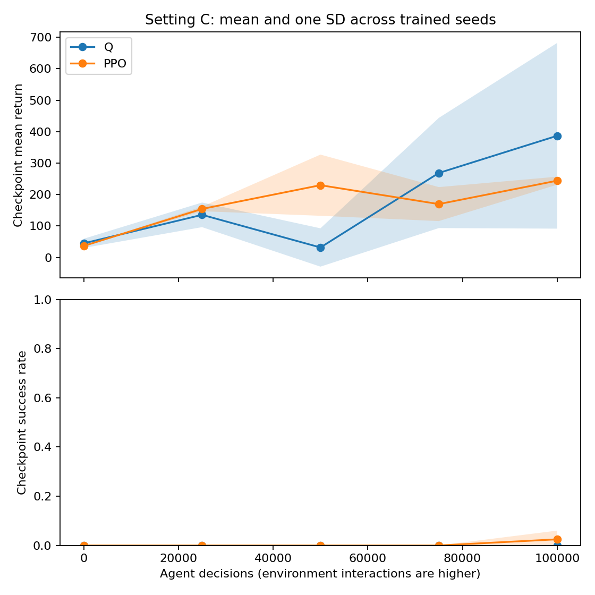

# Part 2 tables

Source: 6 shard file(s), 16 run summaries. Cells are mean ± sample SD across trained seeds. A dash means the measure never occurred, not zero.

## Required evidence, Settings A/B/C

| Setting | Agent | n       | Success rate  | Mean score | Mean return   | Failure rate  | Len (success) | Len (failure) | Timeout rate  | Interactions | Runtime (s) |
|---------|-------|---------|---------------|------------|---------------|---------------|---------------|---------------|---------------|--------------|-------------|
| A       | Q     | 3 seeds | 0.002 ± 0.003 | 649 ± 294  | 648.8 ± 293.8 | 0.998 ± 0.003 | 732.0         | 645.0 ± 80.1  | 0.000 ± 0.000 | 100000 ± 0   | 359 ± 62    |
| A       | PPO   | 2 seeds | 0.003 ± 0.004 | 551 ± 22   | 551.0 ± 22.4  | 0.998 ± 0.004 | 783.0         | 589.7 ± 15.4  | 0.000 ± 0.000 | 100000 ± 0   | 466 ± 10    |
| B       | Q     | 2 seeds | 0.000 ± 0.000 | 426 ± 149  | 425.8 ± 149.1 | 1.000 ± 0.000 | -             | 586.5 ± 65.1  | 0.000 ± 0.000 | 100000 ± 0   | 327 ± 6     |
| B       | PPO   | 1 seeds | 0.000         | 573        | 572.6         | 0.995         | -             | 584.3         | 0.005         | 100000       | 430         |
| C       | Q     | 3 seeds | 0.002 ± 0.003 | 656 ± 188  | 361.1 ± 179.8 | 0.998 ± 0.003 | 424.0         | 589.3 ± 19.9  | 0.000 ± 0.000 | 100000 ± 0   | 343 ± 36    |
| C       | PPO   | 2 seeds | 0.005 ± 0.007 | 566 ± 22   | 266.2 ± 29.4  | 0.995 ± 0.007 | 550.0         | 599.3 ± 14.8  | 0.000 ± 0.000 | 100000 ± 0   | 493 ± 40    |
| D       | Q     | 2 seeds | 0.010 ± 0.007 | 593 ± 163  | 593.2 ± 163.2 | 0.982 ± 0.018 | 789.5 ± 327.4 | 814.4 ± 108.0 | 0.007 ± 0.011 | 0 ± 0        | -           |
| D       | PPO   | 1 seeds | 0.035         | 808        | 808.1         | 0.960         | 829.0         | 761.8         | 0.005         | 0            | -           |

## Setting B versus Setting C

Step penalty effect, C minus B (paired on shared training seeds; returns are omitted because B and C define the reward differently)

| Agent | seeds | success rate Δ | failure rate Δ | timeout rate Δ | mean score Δ |
|-------|-------|----------------|----------------|----------------|--------------|
| Q     | 2     | +0.000 ± 0.000 | +0.000 ± 0.000 | +0.000 ± 0.000 | +279 ± 387   |
| PPO   | 1     | +0.010         | -0.005         | -0.005         | +9           |

## Setting D, transfer from Setting B

Transfer effect, D minus B (paired on shared training seeds; same agents and same reward, evaluated with two ghosts instead of three and no further training. D is NOT an unseen maze: ALE exposes no second MsPacMan maze, so this is a declared change of conditions only)

| Agent | seeds | success rate Δ | failure rate Δ | timeout rate Δ | mean score Δ |
|-------|-------|----------------|----------------|----------------|--------------|
| Q     | 2     | +0.010 ± 0.007 | -0.018 ± 0.018 | +0.007 ± 0.011 | +167 ± 14    |
| PPO   | 1     | +0.035         | -0.035         | +0.000         | +236         |

## Learning curves

Checkpoint mean game score (top) and success rate (bottom) against agent decisions, mean across trained seeds with a band of one sample SD. Success is near zero at the declared 2000-point threshold, so the score panel carries the signal. Environment interactions exceed agent decisions by the per-episode startup steps; both are in seed_results. No smoothing; straight lines between checkpoints. Evaluation frequency, episodes per point and the curve seed range are recorded in part2_config.json.

