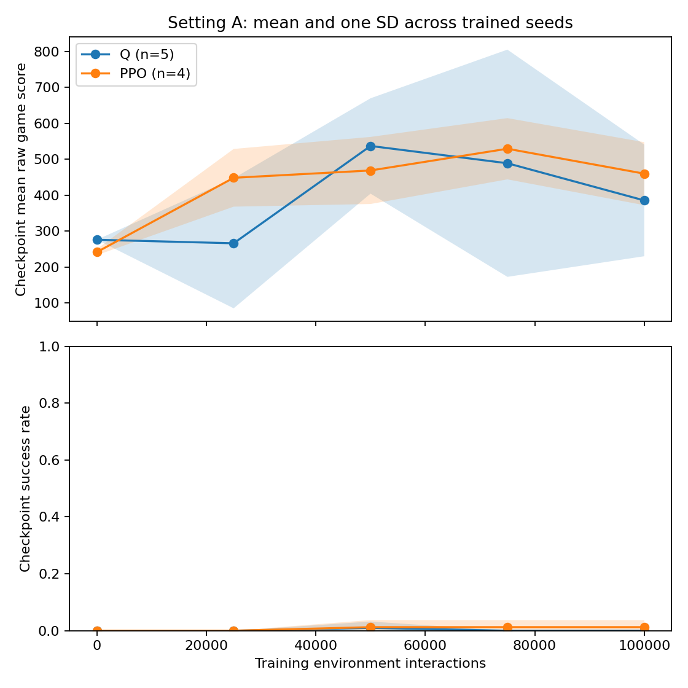
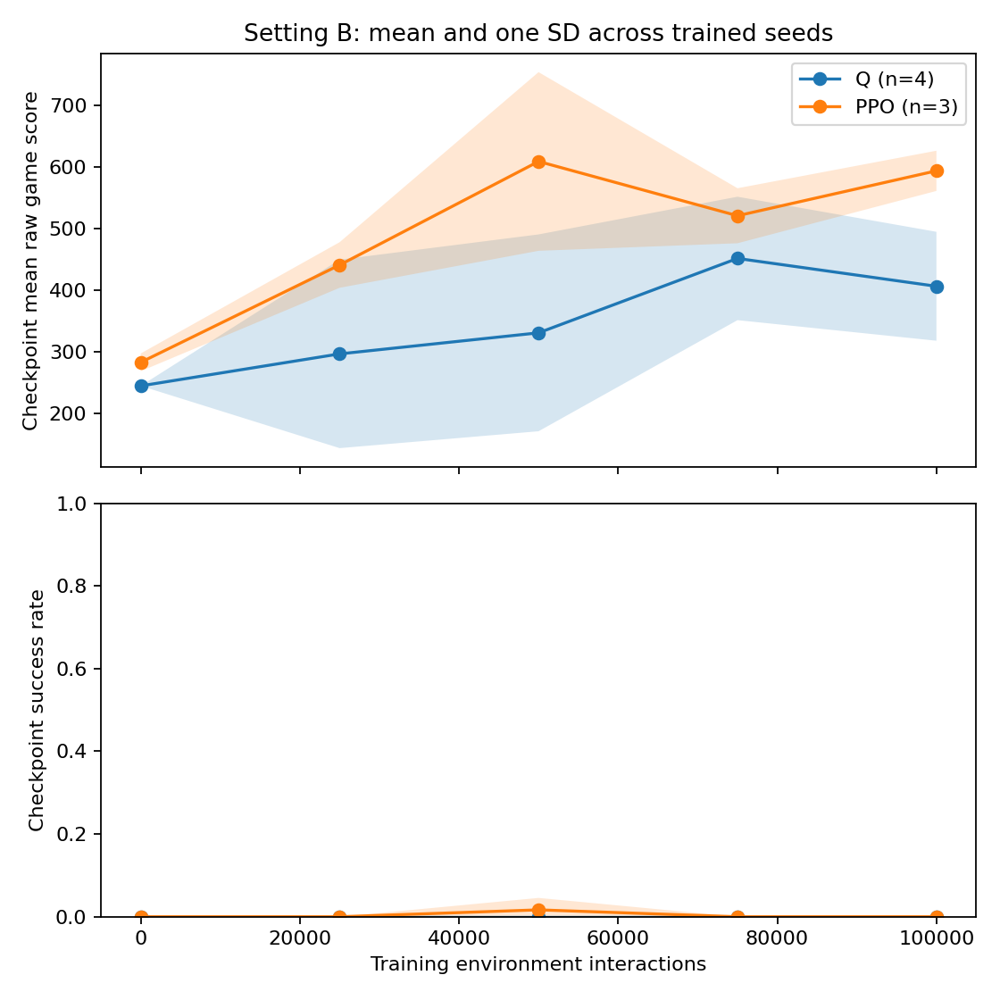
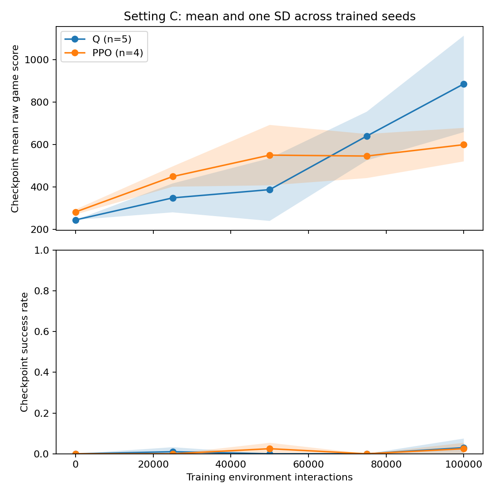

# Part 2 tables

Source: 6 shard file(s), 32 run summaries. Cells are mean ± sample SD across trained seeds. A dash indicates unavailable data or no episodes with that outcome.

## Required evidence, Settings A/B/C/D

| Setting | Agent | n       | Success rate  | Mean score | Mean return   | Cleared rate | Failure rate  | Len (success) | Len (failure) | Timeout rate  | Agent decisions | Training env. steps | Training (s) | Curve eval. (s) | Final eval. (s) | Extra greedy eval. (s) |
|---------|-------|---------|---------------|------------|---------------|--------------|---------------|---------------|---------------|---------------|-----------------|---------------------|--------------|-----------------|-----------------|------------------------|
| A       | Q     | 5 seeds | 0.000 ± 0.000 | 393 ± 166  | 393.4 ± 166.3 | -            | 1.000 ± 0.000 | -             | 547.7 ± 126.4 | 0.000 ± 0.000 | 88469 ± 515     | 100000 ± 0          | 120.4 ± 5.6  | 71.1 ± 5.3      | 138.7 ± 25.6    | 0.0 ± 0.0              |
| A       | PPO   | 4 seeds | 0.000 ± 0.000 | 497 ± 32   | 497.0 ± 32.2  | -            | 1.000 ± 0.000 | -             | 575.3 ± 11.1  | 0.000 ± 0.000 | 89465 ± 348     | 100000 ± 0          | 130.7 ± 6.6  | 74.8 ± 6.0      | 146.1 ± 16.0    | 114.3 ± 10.7           |
| B       | Q     | 4 seeds | 0.003 ± 0.003 | 441 ± 129  | 441.4 ± 129.1 | -            | 0.998 ± 0.003 | 767.0 ± 17.0  | 580.2 ± 73.0  | 0.000 ± 0.000 | 88576 ± 713     | 100000 ± 0          | 124.4 ± 11.2 | 68.0 ± 7.2      | 139.8 ± 18.9    | 0.0 ± 0.0              |
| B       | PPO   | 3 seeds | 0.007 ± 0.006 | 561 ± 5    | 561.2 ± 5.5   | -            | 0.993 ± 0.006 | 558.2 ± 354.6 | 561.9 ± 21.7  | 0.000 ± 0.000 | 89464 ± 288     | 100000 ± 0          | 129.0 ± 5.3  | 73.1 ± 3.0      | 151.1 ± 1.0     | 123.5 ± 40.7           |
| C       | Q     | 5 seeds | 0.023 ± 0.027 | 892 ± 241  | 572.8 ± 220.6 | -            | 0.977 ± 0.027 | 599.6 ± 110.8 | 646.1 ± 53.0  | 0.000 ± 0.000 | 88833 ± 558     | 100000 ± 0          | 117.1 ± 10.5 | 68.3 ± 7.9      | 154.0 ± 21.1    | 0.0 ± 0.0              |
| C       | PPO   | 4 seeds | 0.013 ± 0.010 | 578 ± 32   | 287.4 ± 31.6  | -            | 0.987 ± 0.010 | 644.1 ± 59.2  | 582.0 ± 17.2  | 0.000 ± 0.000 | 89457 ± 149     | 100000 ± 0          | 130.3 ± 8.5  | 72.6 ± 6.1      | 147.2 ± 13.8    | 123.0 ± 30.5           |
| D       | Q     | 4 seeds | 0.001 ± 0.003 | 305 ± 139  | 305.2 ± 139.2 | -            | 0.999 ± 0.003 | 355.0         | 583.5 ± 83.5  | 0.000 ± 0.000 | 0 ± 0           | 0 ± 0               | 0.0 ± 0.0    | -               | 137.0 ± 14.5    | -                      |
| D       | PPO   | 3 seeds | 0.002 ± 0.003 | 472 ± 50   | 471.7 ± 49.9  | -            | 0.990 ± 0.000 | 556.0         | 566.8 ± 31.1  | 0.008 ± 0.003 | 0 ± 0           | 0 ± 0               | 0.0 ± 0.0    | -               | 145.9 ± 19.8    | -                      |

## Setting B versus Setting C

Step penalty effect, C minus B (paired on shared training seeds; returns are omitted because B and C define the reward differently)

| Agent | seeds | success rate Δ | cleared rate Δ | failure rate Δ | timeout rate Δ | mean score Δ |
|-------|-------|----------------|----------------|----------------|----------------|--------------|
| Q     | 4     | +0.021 ± 0.030 | -              | -0.021 ± 0.030 | +0.000 ± 0.000 | +493 ± 382   |
| PPO   | 3     | +0.005 ± 0.010 | -              | -0.005 ± 0.010 | +0.000 ± 0.000 | +7 ± 33      |

## Setting D, transfer from Setting B

Transfer effect, D minus B (paired on shared training seeds; frozen B models on held-out maze 1, same game mode, reward and stickiness. Maze 1 uses a modified Atari start state)

| Agent | seeds | success rate Δ | cleared rate Δ | failure rate Δ | timeout rate Δ | mean score Δ |
|-------|-------|----------------|----------------|----------------|----------------|--------------|
| Q     | 4     | -0.001 ± 0.003 | -              | +0.001 ± 0.003 | +0.000 ± 0.000 | -136 ± 220   |
| PPO   | 3     | -0.005 ± 0.005 | -              | -0.003 ± 0.006 | +0.008 ± 0.003 | -89 ± 48     |

## Learning curves

Points are unsmoothed means across training seeds. Bands show one sample standard deviation when at least two seeds are available.

A: mean raw game score and success rate. Sources: main_PPO_A_123, main_PPO_A_2026, main_PPO_A_42, main_PPO_A_7, main_Q_A_123, main_Q_A_2026, main_Q_A_42, main_Q_A_7, main_Q_A_999.

B: mean raw game score and success rate. Sources: main_PPO_B_2026, main_PPO_B_42, main_PPO_B_7, main_Q_B_123, main_Q_B_2026, main_Q_B_42, main_Q_B_7.

C: mean raw game score and success rate. Sources: main_PPO_C_123, main_PPO_C_2026, main_PPO_C_42, main_PPO_C_7, main_Q_C_123, main_Q_C_2026, main_Q_C_42, main_Q_C_7, main_Q_C_999.

