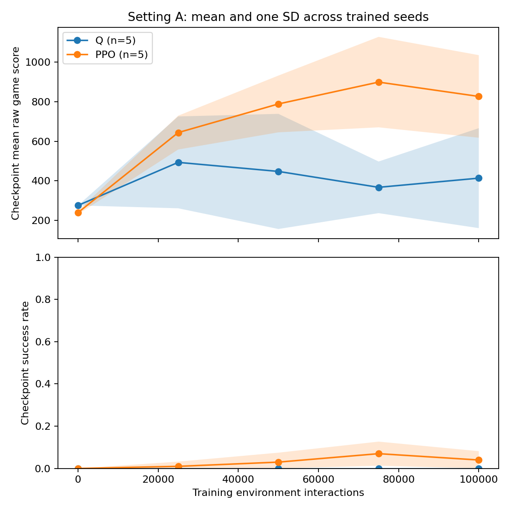
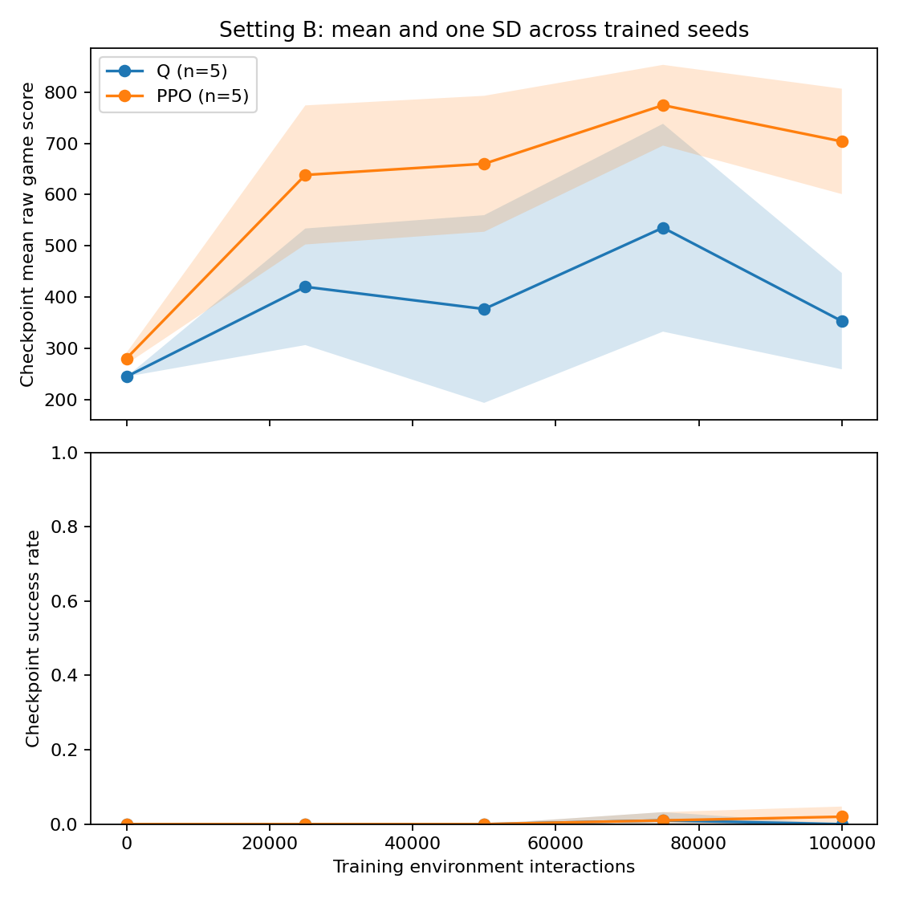
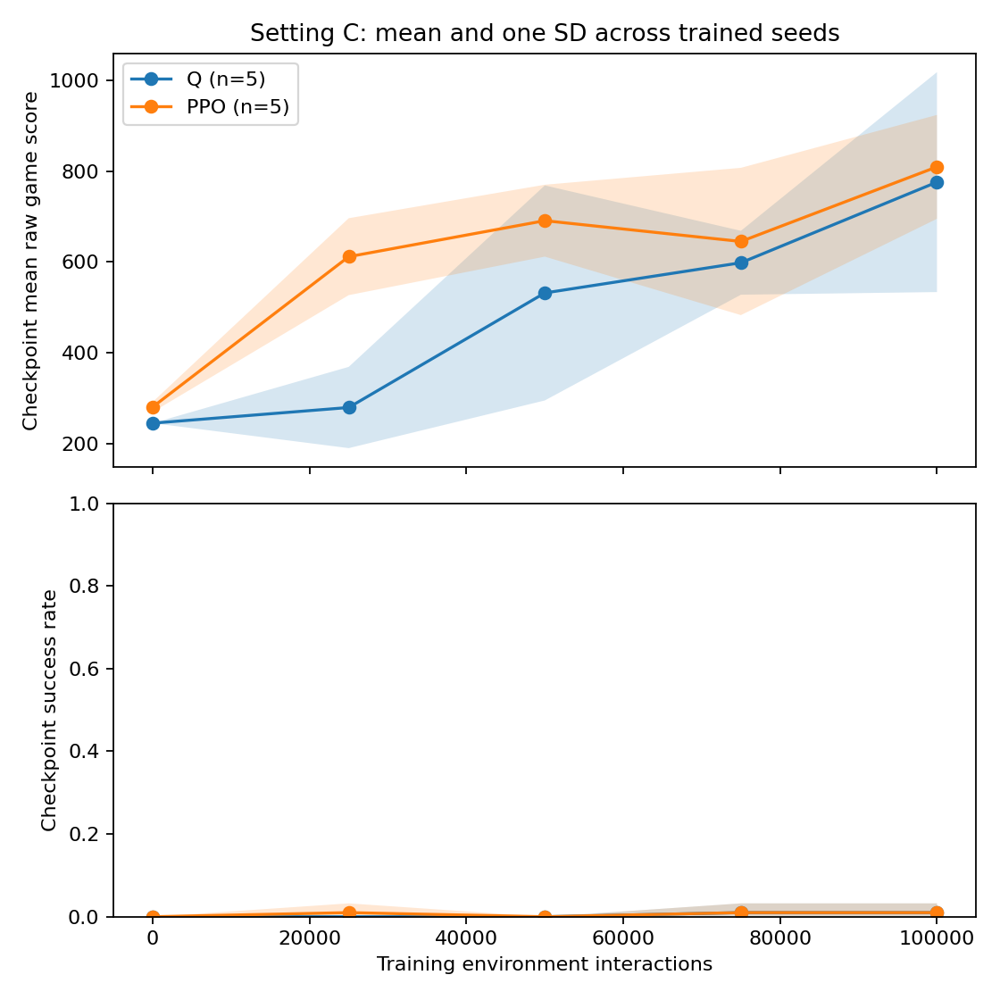

# Part 2 tables

Source: 6 shard file(s), 40 run summaries. Cells are mean ± sample SD across trained seeds. A dash indicates unavailable data or no episodes with that outcome.

## Required evidence, Settings A/B/C/D

| Setting | Agent | n       | Success rate  | Mean score | Mean return   | Cleared rate  | Failure rate  | Len (success) | Len (failure) | Timeout rate  | Agent decisions | Training env. steps | Training (s) | Curve eval. (s) | Final eval. (s) | Extra greedy eval. (s) |
|---------|-------|---------|---------------|------------|---------------|---------------|---------------|---------------|---------------|---------------|-----------------|---------------------|--------------|-----------------|-----------------|------------------------|
| A       | Q     | 5 seeds | 0.000 ± 0.000 | 412 ± 250  | 412.0 ± 250.1 | 0.000 ± 0.000 | 1.000 ± 0.000 | -             | 511.0 ± 119.1 | 0.000 ± 0.000 | 88391 ± 488     | 100000 ± 0          | 76.9 ± 1.3   | 43.9 ± 2.1      | 86.8 ± 14.5     | 0.0 ± 0.0              |
| A       | PPO   | 5 seeds | 0.035 ± 0.040 | 861 ± 197  | 864.2 ± 200.4 | 0.000 ± 0.000 | 0.965 ± 0.040 | 437.4 ± 126.3 | 634.7 ± 31.4  | 0.000 ± 0.000 | 90272 ± 496     | 100000 ± 0          | 81.0 ± 2.5   | 49.9 ± 3.0      | 103.4 ± 8.3     | 76.4 ± 13.1            |
| B       | Q     | 5 seeds | 0.000 ± 0.000 | 332 ± 62   | 332.3 ± 61.6  | 0.000 ± 0.000 | 1.000 ± 0.000 | -             | 471.0 ± 58.7  | 0.000 ± 0.000 | 88227 ± 907     | 100000 ± 0          | 76.7 ± 2.4   | 43.0 ± 3.1      | 80.1 ± 6.8      | 0.0 ± 0.0              |
| B       | PPO   | 5 seeds | 0.016 ± 0.011 | 745 ± 68   | 746.8 ± 68.9  | 0.000 ± 0.000 | 0.984 ± 0.011 | 575.3 ± 93.1  | 635.6 ± 47.0  | 0.000 ± 0.000 | 90302 ± 483     | 100000 ± 0          | 77.2 ± 9.3   | 48.7 ± 4.6      | 98.4 ± 14.0     | 84.1 ± 13.1            |
| C       | Q     | 5 seeds | 0.020 ± 0.013 | 754 ± 224  | 441.3 ± 224.6 | 0.000 ± 0.000 | 0.980 ± 0.013 | 569.9 ± 100.1 | 630.2 ± 27.5  | 0.000 ± 0.000 | 88898 ± 310     | 100000 ± 0          | 76.7 ± 0.8   | 46.2 ± 2.2      | 100.4 ± 1.7     | 0.0 ± 0.0              |
| C       | PPO   | 5 seeds | 0.029 ± 0.013 | 863 ± 99   | 538.8 ± 103.9 | 0.000 ± 0.000 | 0.971 ± 0.013 | 476.0 ± 111.5 | 659.6 ± 43.8  | 0.000 ± 0.000 | 90185 ± 301     | 100000 ± 0          | 80.5 ± 1.8   | 49.9 ± 1.8      | 106.0 ± 2.8     | 85.4 ± 14.2            |
| D       | Q     | 5 seeds | 0.000 ± 0.000 | 245 ± 17   | 244.6 ± 17.2  | 0.000 ± 0.000 | 0.999 ± 0.002 | -             | 510.0 ± 74.7  | 0.001 ± 0.002 | 0 ± 0           | 0 ± 0               | 0.0 ± 0.0    | -               | 85.3 ± 9.3      | -                      |
| D       | PPO   | 5 seeds | 0.008 ± 0.007 | 704 ± 31   | 704.8 ± 31.5  | 0.000 ± 0.000 | 0.977 ± 0.018 | 620.8 ± 194.6 | 659.3 ± 70.5  | 0.015 ± 0.022 | 0 ± 0           | 0 ± 0               | 0.0 ± 0.0    | -               | 99.8 ± 21.5     | -                      |

## Setting B versus Setting C

Step penalty effect, C minus B (paired on shared training seeds; returns are omitted because B and C define the reward differently)

| Agent | seeds | success rate Δ | cleared rate Δ | failure rate Δ | timeout rate Δ | mean score Δ |
|-------|-------|----------------|----------------|----------------|----------------|--------------|
| Q     | 5     | +0.020 ± 0.013 | +0.000 ± 0.000 | -0.020 ± 0.013 | +0.000 ± 0.000 | +421 ± 279   |
| PPO   | 5     | +0.013 ± 0.016 | +0.000 ± 0.000 | -0.013 ± 0.016 | +0.000 ± 0.000 | +118 ± 156   |

## Setting D, transfer from Setting B

Transfer effect, D minus B (paired on shared training seeds; frozen B models on held-out maze 1, same game mode, reward and stickiness. Maze 1 uses a modified Atari start state)

| Agent | seeds | success rate Δ | cleared rate Δ | failure rate Δ | timeout rate Δ | mean score Δ |
|-------|-------|----------------|----------------|----------------|----------------|--------------|
| Q     | 5     | +0.000 ± 0.000 | +0.000 ± 0.000 | -0.001 ± 0.002 | +0.001 ± 0.002 | -88 ± 50     |
| PPO   | 5     | -0.008 ± 0.012 | +0.000 ± 0.000 | -0.007 ± 0.024 | +0.015 ± 0.022 | -41 ± 53     |

## Learning curves

Points are unsmoothed means across training seeds. Bands show one sample standard deviation when at least two seeds are available.

A: mean raw game score and success rate. Sources: main_PPO_A_123, main_PPO_A_2026, main_PPO_A_42, main_PPO_A_7, main_PPO_A_999, main_Q_A_123, main_Q_A_2026, main_Q_A_42, main_Q_A_7, main_Q_A_999.

B: mean raw game score and success rate. Sources: main_PPO_B_123, main_PPO_B_2026, main_PPO_B_42, main_PPO_B_7, main_PPO_B_999, main_Q_B_123, main_Q_B_2026, main_Q_B_42, main_Q_B_7, main_Q_B_999.

C: mean raw game score and success rate. Sources: main_PPO_C_123, main_PPO_C_2026, main_PPO_C_42, main_PPO_C_7, main_PPO_C_999, main_Q_C_123, main_Q_C_2026, main_Q_C_42, main_Q_C_7, main_Q_C_999.

