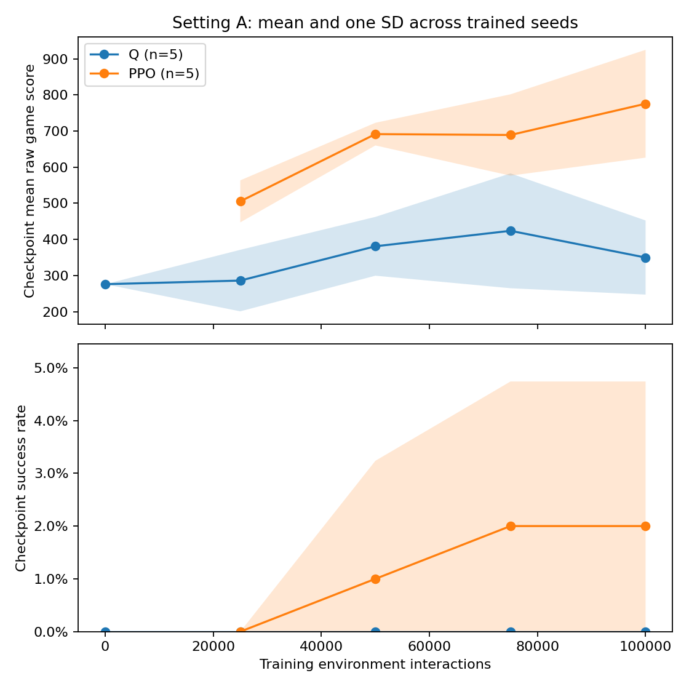
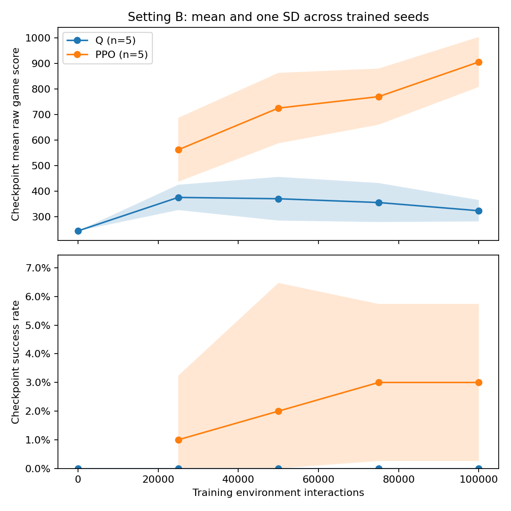
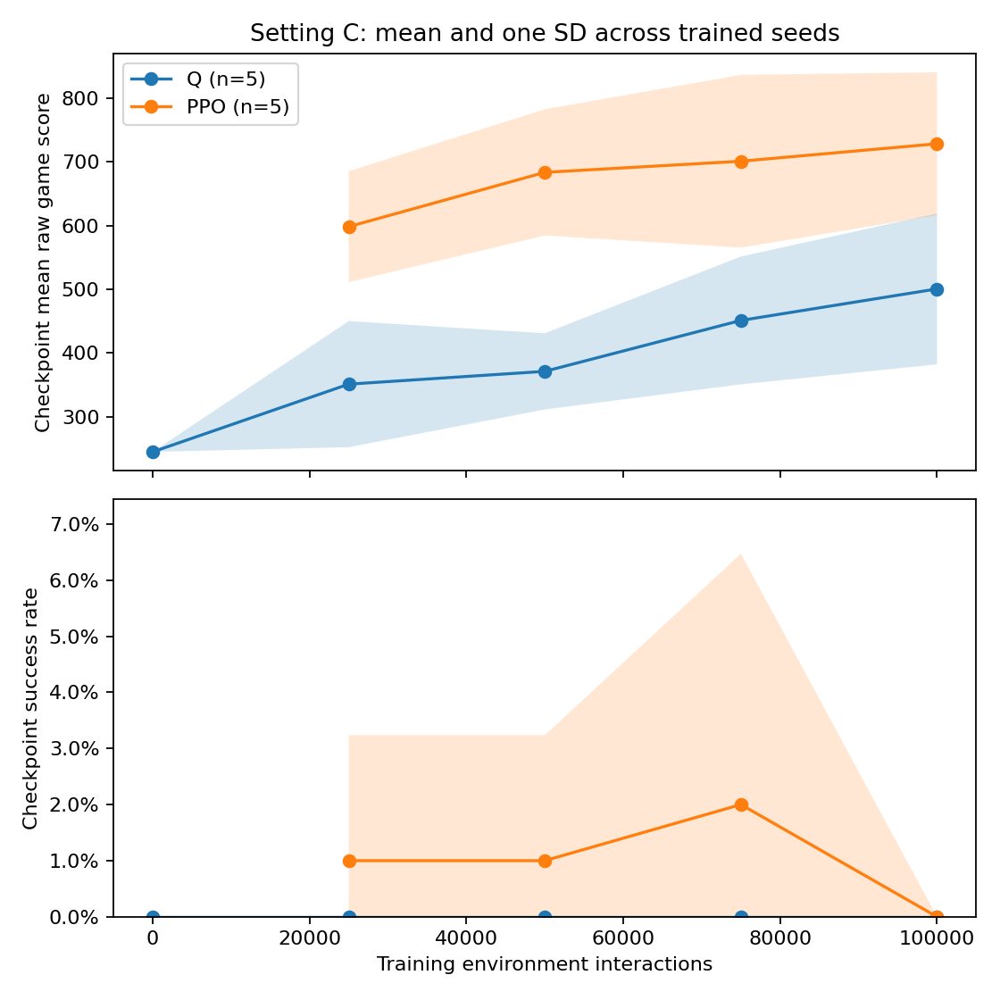

# Part 2 tables

Source: 6 shard file(s), 40 run summaries. Cells are mean ± sample SD across trained seeds. A dash indicates unavailable data or no episodes with that outcome.

Protocol: `mspacman_maze_pellets_walls_v6`. Training rows: 30/30; transfer rows: 10/10 for the standard five-seed study.

## Outcomes, Settings A/B/C/D

| Setting | Agent | n       | Success rate  | Mean score | Mean return   | Cleared rate  | Failure rate  | Timeout rate  |
|---------|-------|---------|---------------|------------|---------------|---------------|---------------|---------------|
| A       | Q     | 5 seeds | 0.000 ± 0.000 | 352 ± 98   | 351.8 ± 98.5  | 0.000 ± 0.000 | 1.000 ± 0.000 | 0.000 ± 0.000 |
| A       | PPO   | 5 seeds | 0.018 ± 0.010 | 773 ± 117  | 774.8 ± 117.5 | 0.000 ± 0.000 | 0.982 ± 0.010 | 0.000 ± 0.000 |
| B       | Q     | 5 seeds | 0.000 ± 0.000 | 381 ± 32   | 380.9 ± 31.8  | 0.000 ± 0.000 | 1.000 ± 0.000 | 0.000 ± 0.000 |
| B       | PPO   | 5 seeds | 0.026 ± 0.019 | 826 ± 139  | 828.7 ± 140.7 | 0.000 ± 0.000 | 0.974 ± 0.019 | 0.000 ± 0.000 |
| C       | Q     | 5 seeds | 0.005 ± 0.006 | 501 ± 105  | 241.3 ± 86.2  | 0.000 ± 0.000 | 0.995 ± 0.006 | 0.000 ± 0.000 |
| C       | PPO   | 5 seeds | 0.014 ± 0.012 | 733 ± 108  | 434.7 ± 82.6  | 0.000 ± 0.000 | 0.986 ± 0.012 | 0.000 ± 0.000 |
| D       | Q     | 5 seeds | 0.000 ± 0.000 | 255 ± 63   | 255.4 ± 63.5  | 0.000 ± 0.000 | 1.000 ± 0.000 | 0.000 ± 0.000 |
| D       | PPO   | 5 seeds | 0.023 ± 0.022 | 712 ± 141  | 713.9 ± 141.8 | 0.000 ± 0.000 | 0.974 ± 0.021 | 0.003 ± 0.003 |

## Episode lengths and state coverage

| Setting | Agent | n       | Len (success) | Len (failure) | Unseen states |
|---------|-------|---------|---------------|---------------|---------------|
| A       | Q     | 5 seeds | -             | 514.2 ± 67.9  | 0.026 ± 0.035 |
| A       | PPO   | 5 seeds | 498.4 ± 112.6 | 626.4 ± 50.5  | 0.000 ± 0.000 |
| B       | Q     | 5 seeds | -             | 489.9 ± 15.2  | 0.085 ± 0.015 |
| B       | PPO   | 5 seeds | 535.5 ± 98.3  | 612.0 ± 67.7  | 0.000 ± 0.000 |
| C       | Q     | 5 seeds | 536.8 ± 112.4 | 519.8 ± 58.1  | 0.132 ± 0.044 |
| C       | PPO   | 5 seeds | 602.1 ± 188.4 | 599.9 ± 66.5  | 0.000 ± 0.000 |
| D       | Q     | 5 seeds | -             | 467.0 ± 20.9  | 0.105 ± 0.048 |
| D       | PPO   | 5 seeds | 566.6 ± 79.6  | 615.3 ± 80.8  | 0.000 ± 0.000 |

Lengths are agent decisions, excluding startup. Conditional lengths omit seeds with no matching outcomes; B-C length differences compare different sets of successful/failed episodes, not identical trajectories. Unseen state coverage applies to Q only; PPO has no lookup table.

## Computation

| Setting | Agent | n       | Agent decisions | Training env. steps | Training (s) | Curve eval. (s) | Final eval. (s) | Extra greedy eval. (s) |
|---------|-------|---------|-----------------|---------------------|--------------|-----------------|-----------------|------------------------|
| A       | Q     | 5 seeds | 87984 ± 278     | 100000 ± 0          | 60.0 ± 0.3   | 32.9 ± 1.3      | 68.8 ± 6.4      | 0.0 ± 0.0              |
| A       | PPO   | 5 seeds | 90049 ± 232     | 100000 ± 0          | 80.2 ± 1.0   | 40.5 ± 1.0      | 103.5 ± 6.3     | 76.5 ± 10.1            |
| B       | Q     | 5 seeds | 87986 ± 208     | 100000 ± 0          | 76.3 ± 0.5   | 41.5 ± 0.7      | 84.1 ± 2.1      | 0.0 ± 0.0              |
| B       | PPO   | 5 seeds | 89860 ± 130     | 100000 ± 0          | 77.1 ± 5.9   | 38.8 ± 3.7      | 98.3 ± 14.5     | 96.5 ± 22.0            |
| C       | Q     | 5 seeds | 88222 ± 213     | 100000 ± 0          | 75.8 ± 0.8   | 41.9 ± 1.7      | 87.1 ± 6.9      | 0.0 ± 0.0              |
| C       | PPO   | 5 seeds | 89899 ± 223     | 100000 ± 0          | 80.9 ± 1.3   | 41.0 ± 2.7      | 100.5 ± 8.0     | 91.4 ± 14.5            |
| D       | Q     | 5 seeds | 0 ± 0           | 0 ± 0               | 0.0 ± 0.0    | -               | 81.7 ± 2.4      | -                      |
| D       | PPO   | 5 seeds | 0 ± 0           | 0 ± 0               | 0.0 ± 0.0    | -               | 96.7 ± 14.3     | -                      |

## Additional greedy PPO evaluation

| Setting | Trained seeds | Success rate  | Mean score | Mean return   |
|---------|---------------|---------------|------------|---------------|
| A       | 5             | 0.000 ± 0.000 | 260 ± 153  | 260.0 ± 153.0 |
| B       | 5             | 0.002 ± 0.004 | 504 ± 178  | 504.0 ± 178.4 |
| C       | 5             | 0.000 ± 0.000 | 566 ± 216  | 285.6 ± 202.8 |

Primary PPO results use sampled actions. Greedy results are a separate evaluation mode and are not pooled with primary results.

## Setting B versus Setting C

Step penalty effect, C minus B (paired on shared training seeds; returns are omitted because B and C define the reward differently)

| Agent | seeds | success rate Δ | cleared rate Δ | failure rate Δ | timeout rate Δ | mean score Δ | success length Δ | failure length Δ |
|-------|-------|----------------|----------------|----------------|----------------|--------------|------------------|------------------|
| Q     | 5     | +0.005 ± 0.006 | +0.000 ± 0.000 | -0.005 ± 0.006 | +0.000 ± 0.000 | +120 ± 77    | -                | +29.8 ± 57.1     |
| PPO   | 5     | -0.012 ± 0.030 | +0.000 ± 0.000 | +0.012 ± 0.030 | +0.000 ± 0.000 | -93 ± 195    | +66.6 ± 233.0    | -12.1 ± 94.9     |

## Setting A versus Setting B

Uncertainty effect, B minus A (paired on shared training seeds; same reward, so score and return both compare; only the sticky-action probability changes. Route choice is not established by these numbers, it needs episode traces)

| Agent | seeds | success rate Δ | cleared rate Δ | failure rate Δ | timeout rate Δ | mean score Δ | success length Δ | failure length Δ |
|-------|-------|----------------|----------------|----------------|----------------|--------------|------------------|------------------|
| Q     | 5     | +0.000 ± 0.000 | +0.000 ± 0.000 | +0.000 ± 0.000 | +0.000 ± 0.000 | +29 ± 107    | -                | -24.2 ± 70.8     |
| PPO   | 5     | +0.008 ± 0.025 | +0.000 ± 0.000 | -0.008 ± 0.025 | +0.000 ± 0.000 | +53 ± 227    | +37.1 ± 185.7    | -14.4 ± 91.8     |

## Setting D, transfer from Setting B

Transfer effect, D minus B (paired on shared training seeds; frozen B models on held-out maze 1, same game mode, reward and stickiness. Maze 1 uses a modified Atari start state)

| Agent | seeds | success rate Δ | cleared rate Δ | failure rate Δ | timeout rate Δ | mean score Δ | success length Δ | failure length Δ |
|-------|-------|----------------|----------------|----------------|----------------|--------------|------------------|------------------|
| Q     | 5     | +0.000 ± 0.000 | +0.000 ± 0.000 | +0.000 ± 0.000 | +0.000 ± 0.000 | -126 ± 72    | -                | -23.0 ± 28.1     |
| PPO   | 5     | -0.003 ± 0.021 | +0.000 ± 0.000 | +0.000 ± 0.019 | +0.003 ± 0.003 | -115 ± 100   | +31.1 ± 56.4     | +3.3 ± 38.4      |

## Learning curves

Points are unsmoothed means across training seeds. Bands show one sample standard deviation when at least two seeds are available.

A: mean raw game score and success rate. Sources: main_PPO_A_123, main_PPO_A_2026, main_PPO_A_42, main_PPO_A_7, main_PPO_A_999, main_Q_A_123, main_Q_A_2026, main_Q_A_42, main_Q_A_7, main_Q_A_999.

B: mean raw game score and success rate. Sources: main_PPO_B_123, main_PPO_B_2026, main_PPO_B_42, main_PPO_B_7, main_PPO_B_999, main_Q_B_123, main_Q_B_2026, main_Q_B_42, main_Q_B_7, main_Q_B_999.

C: mean raw game score and success rate. Sources: main_PPO_C_123, main_PPO_C_2026, main_PPO_C_42, main_PPO_C_7, main_PPO_C_999, main_Q_C_123, main_Q_C_2026, main_Q_C_42, main_Q_C_7, main_Q_C_999.

