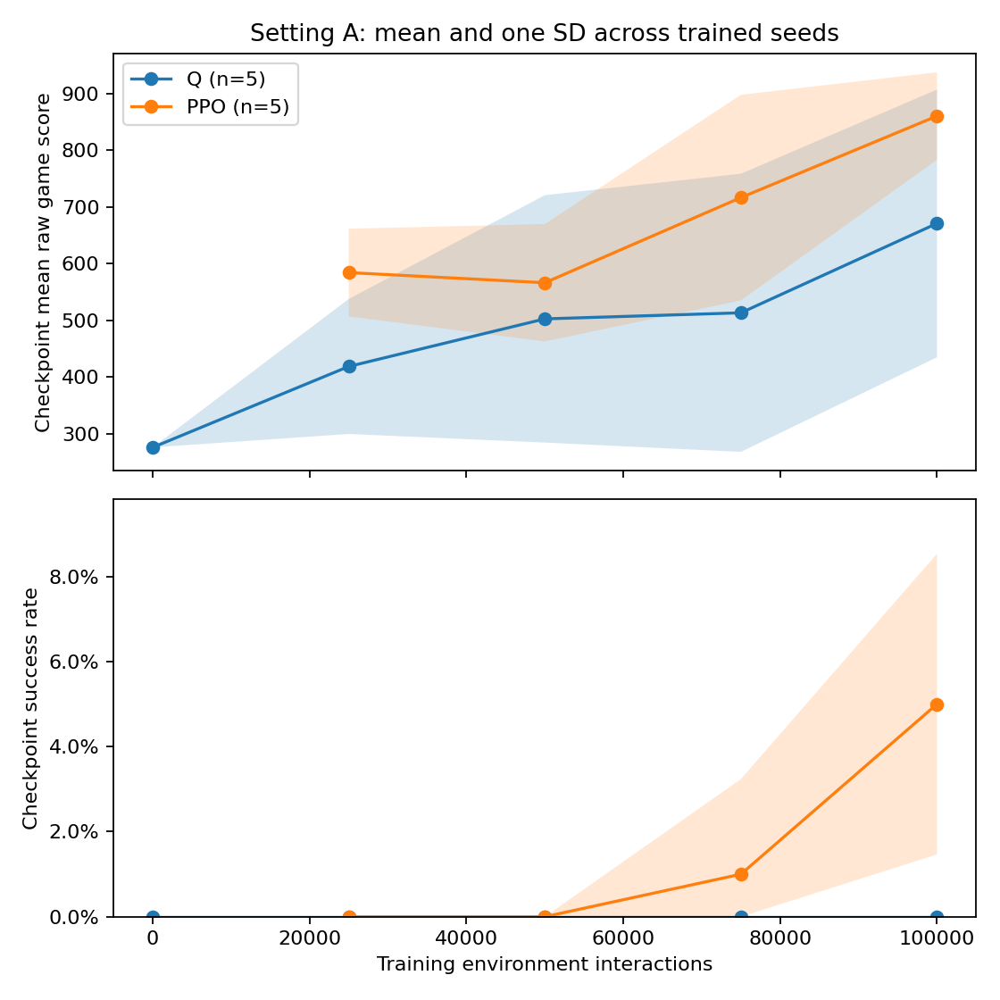
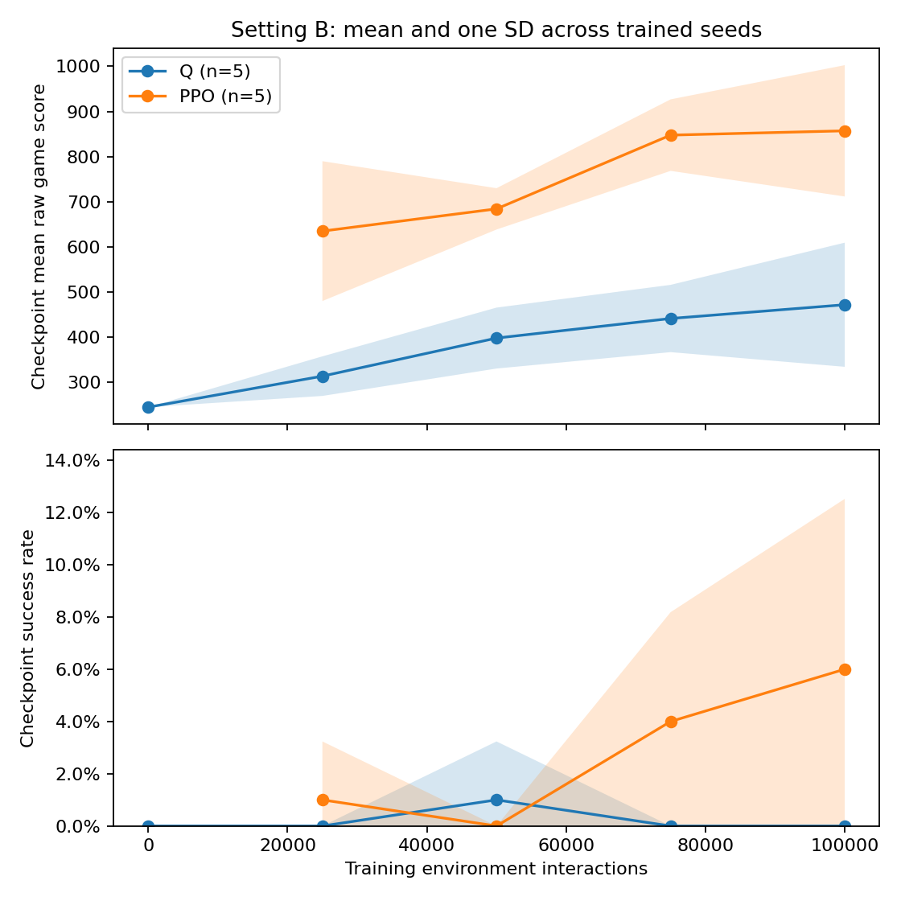
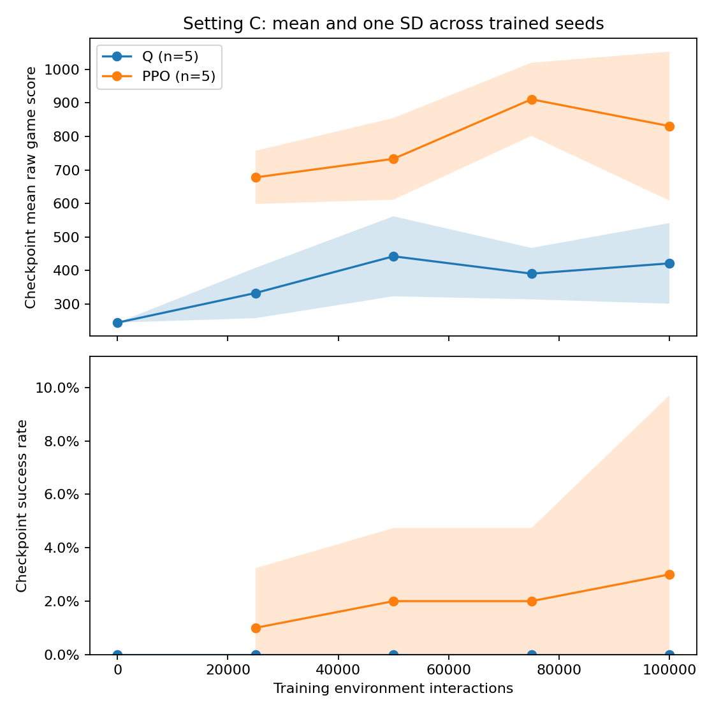

# Part 2 tables

Source: 6 shard file(s), 40 run summaries. Cells are mean ± sample SD across trained seeds. A dash indicates unavailable data or no episodes with that outcome.

Protocol: `mspacman_maze_pellets_walls_v8`. Training rows: 30/30; transfer rows: 10/10 for the standard five-seed study.

## Outcomes, Settings A/B/C/D

| Setting | Agent | n       | Success rate  | Mean score | Mean return   | Cleared rate  | Failure rate  | Timeout rate  |
|---------|-------|---------|---------------|------------|---------------|---------------|---------------|---------------|
| A       | Q     | 5 seeds | 0.002 ± 0.003 | 649 ± 231  | 649.0 ± 231.4 | 0.000 ± 0.000 | 0.998 ± 0.003 | 0.000 ± 0.000 |
| A       | PPO   | 5 seeds | 0.027 ± 0.019 | 836 ± 105  | 838.4 ± 107.3 | 0.000 ± 0.000 | 0.973 ± 0.019 | 0.000 ± 0.000 |
| B       | Q     | 5 seeds | 0.002 ± 0.004 | 478 ± 103  | 478.0 ± 102.5 | 0.000 ± 0.000 | 0.998 ± 0.004 | 0.000 ± 0.000 |
| B       | PPO   | 5 seeds | 0.029 ± 0.011 | 808 ± 118  | 810.5 ± 119.0 | 0.000 ± 0.000 | 0.971 ± 0.011 | 0.000 ± 0.000 |
| C       | Q     | 5 seeds | 0.001 ± 0.002 | 423 ± 77   | 176.0 ± 60.2  | 0.000 ± 0.000 | 0.999 ± 0.002 | 0.000 ± 0.000 |
| C       | PPO   | 5 seeds | 0.046 ± 0.022 | 837 ± 124  | 538.1 ± 112.1 | 0.000 ± 0.000 | 0.954 ± 0.022 | 0.000 ± 0.000 |
| D       | Q     | 5 seeds | 0.000 ± 0.000 | 254 ± 45   | 253.6 ± 44.8  | 0.000 ± 0.000 | 1.000 ± 0.000 | 0.000 ± 0.000 |
| D       | PPO   | 5 seeds | 0.005 ± 0.006 | 576 ± 67   | 576.7 ± 67.5  | 0.000 ± 0.000 | 0.987 ± 0.014 | 0.008 ± 0.009 |

## Episode lengths and state coverage

| Setting | Agent | n       | Len (success) | Len (failure) | Unseen states |
|---------|-------|---------|---------------|---------------|---------------|
| A       | Q     | 5 seeds | 650.0 ± 59.4  | 587.7 ± 118.5 | 0.160 ± 0.086 |
| A       | PPO   | 5 seeds | 615.3 ± 176.1 | 619.3 ± 54.1  | 0.000 ± 0.000 |
| B       | Q     | 5 seeds | 511.0         | 551.1 ± 30.2  | 0.114 ± 0.036 |
| B       | PPO   | 5 seeds | 626.9 ± 213.8 | 629.5 ± 47.6  | 0.000 ± 0.000 |
| C       | Q     | 5 seeds | 442.0         | 493.6 ± 45.3  | 0.117 ± 0.041 |
| C       | PPO   | 5 seeds | 434.2 ± 63.7  | 614.1 ± 28.2  | 0.000 ± 0.000 |
| D       | Q     | 5 seeds | -             | 482.4 ± 51.6  | 0.137 ± 0.039 |
| D       | PPO   | 5 seeds | 613.0 ± 215.9 | 572.5 ± 58.9  | 0.000 ± 0.000 |

Lengths are agent decisions, excluding startup. Conditional lengths omit seeds with no matching outcomes; B-C length differences compare different sets of successful/failed episodes, not identical trajectories. Unseen state coverage applies to Q only; PPO has no lookup table.

## Computation

| Setting | Agent | n       | Agent decisions | Training env. steps | Training (s) | Curve eval. (s) | Final eval. (s) | Extra greedy eval. (s) |
|---------|-------|---------|-----------------|---------------------|--------------|-----------------|-----------------|------------------------|
| A       | Q     | 5 seeds | 88534 ± 428     | 100000 ± 0          | 75.7 ± 4.1   | 43.7 ± 4.7      | 96.4 ± 16.2     | 0.0 ± 0.0              |
| A       | PPO   | 5 seeds | 89379 ± 847     | 100000 ± 0          | 83.1 ± 5.8   | 40.5 ± 4.8      | 103.6 ± 11.0    | 99.1 ± 26.8            |
| B       | Q     | 5 seeds | 88456 ± 314     | 100000 ± 0          | 78.9 ± 6.5   | 44.6 ± 3.8      | 97.2 ± 11.3     | 0.0 ± 0.0              |
| B       | PPO   | 5 seeds | 89917 ± 313     | 100000 ± 0          | 79.3 ± 9.2   | 41.3 ± 5.1      | 101.5 ± 12.0    | 88.6 ± 28.9            |
| C       | Q     | 5 seeds | 87923 ± 458     | 100000 ± 0          | 78.8 ± 6.4   | 42.2 ± 2.2      | 88.4 ± 5.5      | 0.0 ± 0.0              |
| C       | PPO   | 5 seeds | 89951 ± 488     | 100000 ± 0          | 82.8 ± 6.7   | 42.9 ± 3.7      | 102.3 ± 9.7     | 97.4 ± 8.1             |
| D       | Q     | 5 seeds | 0 ± 0           | 0 ± 0               | 0.0 ± 0.0    | -               | 88.7 ± 9.1      | -                      |
| D       | PPO   | 5 seeds | 0 ± 0           | 0 ± 0               | 0.0 ± 0.0    | -               | 94.4 ± 14.6     | -                      |

## Additional greedy PPO evaluation

| Setting | Trained seeds | Success rate  | Mean score | Mean return   |
|---------|---------------|---------------|------------|---------------|
| A       | 5             | 0.000 ± 0.000 | 558 ± 295  | 558.0 ± 295.2 |
| B       | 5             | 0.000 ± 0.000 | 289 ± 257  | 288.8 ± 256.8 |
| C       | 5             | 0.003 ± 0.004 | 555 ± 298  | 263.9 ± 282.5 |

Primary PPO results use sampled actions. Greedy results are a separate evaluation mode and are not pooled with primary results.

## Setting B versus Setting C

Step penalty effect, C minus B (paired on shared training seeds; returns are omitted because B and C define the reward differently)

| Agent | seeds | success rate Δ | cleared rate Δ | failure rate Δ | timeout rate Δ | mean score Δ | success length Δ | failure length Δ |
|-------|-------|----------------|----------------|----------------|----------------|--------------|------------------|------------------|
| Q     | 5     | -0.001 ± 0.005 | +0.000 ± 0.000 | +0.001 ± 0.005 | +0.000 ± 0.000 | -55 ± 123    | -                | -57.6 ± 67.5     |
| PPO   | 5     | +0.017 ± 0.021 | +0.000 ± 0.000 | -0.017 ± 0.021 | +0.000 ± 0.000 | +29 ± 221    | -192.7 ± 267.4   | -15.4 ± 72.7     |

## Setting A versus Setting B

Uncertainty effect, B minus A (paired on shared training seeds; same reward, so score and return both compare; only the sticky-action probability changes. Route choice is not established by these numbers, it needs episode traces)

| Agent | seeds | success rate Δ | cleared rate Δ | failure rate Δ | timeout rate Δ | mean score Δ | success length Δ | failure length Δ |
|-------|-------|----------------|----------------|----------------|----------------|--------------|------------------|------------------|
| Q     | 5     | +0.000 ± 0.006 | +0.000 ± 0.000 | +0.000 ± 0.006 | +0.000 ± 0.000 | -171 ± 269   | -                | -36.6 ± 112.2    |
| PPO   | 5     | +0.002 ± 0.025 | +0.000 ± 0.000 | -0.002 ± 0.025 | +0.000 ± 0.000 | -28 ± 164    | +11.5 ± 125.7    | +10.2 ± 44.2     |

## Setting D, transfer from Setting B

Transfer effect, D minus B (paired on shared training seeds; frozen B models on held-out maze 1, same game mode, reward and stickiness. Maze 1 uses a modified Atari start state)

| Agent | seeds | success rate Δ | cleared rate Δ | failure rate Δ | timeout rate Δ | mean score Δ | success length Δ | failure length Δ |
|-------|-------|----------------|----------------|----------------|----------------|--------------|------------------|------------------|
| Q     | 5     | -0.002 ± 0.004 | +0.000 ± 0.000 | +0.002 ± 0.004 | +0.000 ± 0.000 | -224 ± 127   | -                | -68.8 ± 41.7     |
| PPO   | 5     | -0.024 ± 0.012 | +0.000 ± 0.000 | +0.016 ± 0.012 | +0.008 ± 0.009 | -231 ± 63    | +127.4 ± 238.8   | -57.0 ± 27.2     |

## Learning curves

Points are unsmoothed means across training seeds. Bands show one sample standard deviation when at least two seeds are available.

A: mean raw game score and success rate. Sources: main_PPO_A_123, main_PPO_A_2026, main_PPO_A_42, main_PPO_A_7, main_PPO_A_999, main_Q_A_123, main_Q_A_2026, main_Q_A_42, main_Q_A_7, main_Q_A_999.

B: mean raw game score and success rate. Sources: main_PPO_B_123, main_PPO_B_2026, main_PPO_B_42, main_PPO_B_7, main_PPO_B_999, main_Q_B_123, main_Q_B_2026, main_Q_B_42, main_Q_B_7, main_Q_B_999.

C: mean raw game score and success rate. Sources: main_PPO_C_123, main_PPO_C_2026, main_PPO_C_42, main_PPO_C_7, main_PPO_C_999, main_Q_C_123, main_Q_C_2026, main_Q_C_42, main_Q_C_7, main_Q_C_999.

