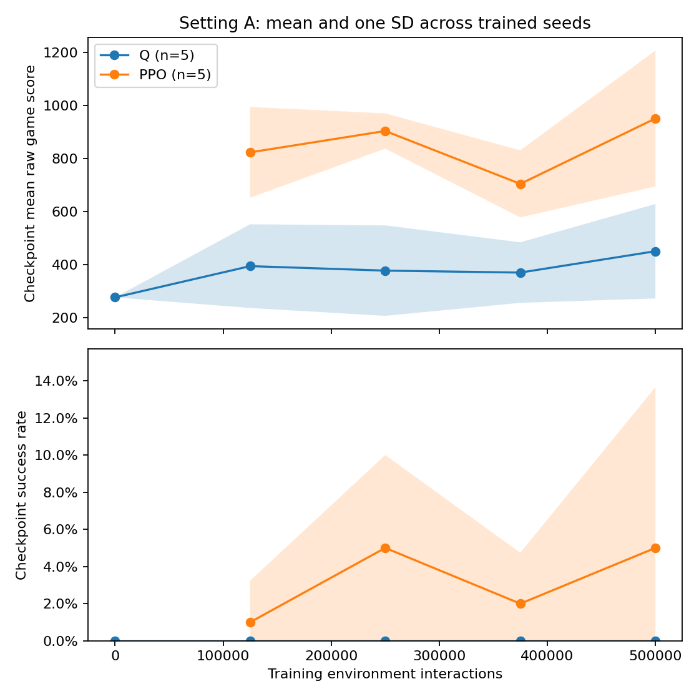
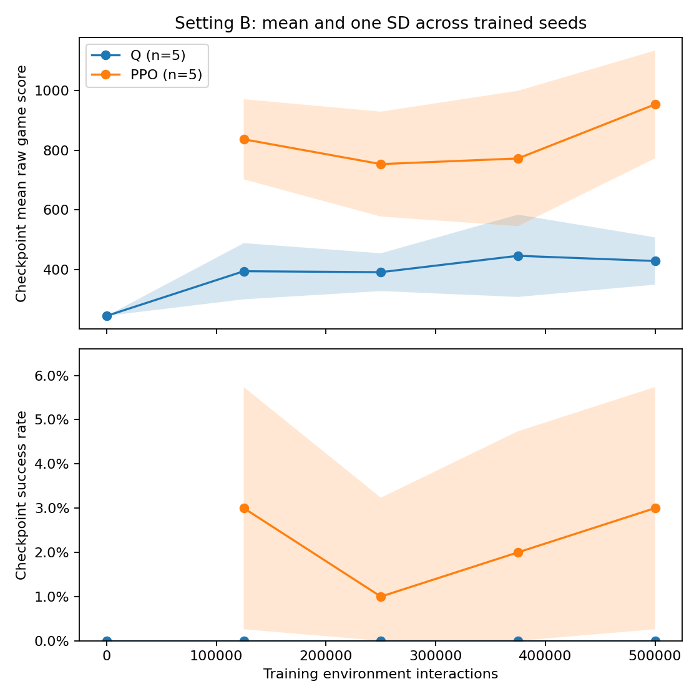
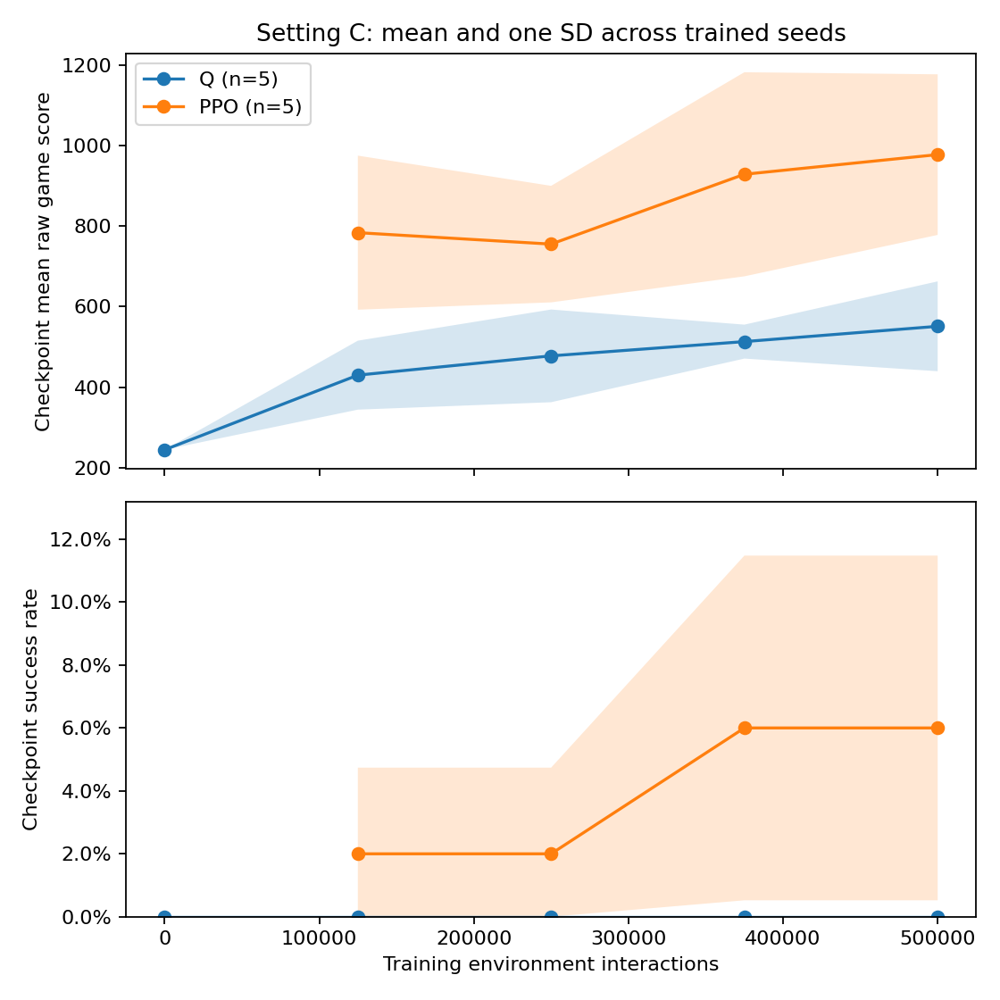

# Part 2 tables

Source: 6 shard file(s), 40 run summaries. Cells are mean ± sample SD across trained seeds. A dash indicates unavailable data or no episodes with that outcome.

Protocol: `mspacman_maze_pellets_walls_v8`. Training rows: 30/30; transfer rows: 10/10 for the standard five-seed study.

## Outcomes, Settings A/B/C/D

| Setting | Agent | n       | Success rate  | Mean score | Mean return   | Cleared rate  | Failure rate  | Timeout rate  |
|---------|-------|---------|---------------|------------|---------------|---------------|---------------|---------------|
| A       | Q     | 5 seeds | 0.002 ± 0.004 | 445 ± 173  | 444.8 ± 173.5 | 0.000 ± 0.000 | 0.998 ± 0.004 | 0.000 ± 0.000 |
| A       | PPO   | 5 seeds | 0.055 ± 0.059 | 977 ± 219  | 982.1 ± 224.5 | 0.000 ± 0.000 | 0.945 ± 0.059 | 0.000 ± 0.000 |
| B       | Q     | 5 seeds | 0.003 ± 0.004 | 445 ± 63   | 444.8 ± 63.4  | 0.000 ± 0.000 | 0.997 ± 0.004 | 0.000 ± 0.000 |
| B       | PPO   | 5 seeds | 0.028 ± 0.017 | 902 ± 136  | 904.7 ± 136.9 | 0.000 ± 0.000 | 0.972 ± 0.017 | 0.000 ± 0.000 |
| C       | Q     | 5 seeds | 0.002 ± 0.003 | 526 ± 127  | 247.8 ± 107.1 | 0.000 ± 0.000 | 0.998 ± 0.003 | 0.000 ± 0.000 |
| C       | PPO   | 5 seeds | 0.053 ± 0.034 | 964 ± 191  | 659.5 ± 176.8 | 0.000 ± 0.000 | 0.947 ± 0.034 | 0.000 ± 0.000 |
| D       | Q     | 5 seeds | 0.001 ± 0.002 | 249 ± 56   | 249.3 ± 56.0  | 0.000 ± 0.000 | 0.999 ± 0.002 | 0.000 ± 0.000 |
| D       | PPO   | 5 seeds | 0.010 ± 0.015 | 617 ± 160  | 618.5 ± 161.0 | 0.000 ± 0.000 | 0.981 ± 0.020 | 0.009 ± 0.017 |

## Episode lengths and state coverage

| Setting | Agent | n       | Len (success) | Len (failure) | Unseen states |
|---------|-------|---------|---------------|---------------|---------------|
| A       | Q     | 5 seeds | 930.0         | 526.1 ± 114.4 | 0.031 ± 0.063 |
| A       | PPO   | 5 seeds | 433.7 ± 65.5  | 670.4 ± 64.0  | 0.000 ± 0.000 |
| B       | Q     | 5 seeds | 674.5 ± 173.2 | 506.6 ± 24.1  | 0.043 ± 0.010 |
| B       | PPO   | 5 seeds | 498.3 ± 58.2  | 625.1 ± 39.0  | 0.000 ± 0.000 |
| C       | Q     | 5 seeds | 582.0 ± 239.0 | 556.3 ± 41.2  | 0.062 ± 0.025 |
| C       | PPO   | 5 seeds | 418.0 ± 49.2  | 631.7 ± 55.5  | 0.000 ± 0.000 |
| D       | Q     | 5 seeds | 503.0         | 462.0 ± 31.5  | 0.090 ± 0.036 |
| D       | PPO   | 5 seeds | 516.3 ± 71.8  | 599.6 ± 60.8  | 0.000 ± 0.000 |

Lengths are agent decisions, excluding startup. Conditional lengths omit seeds with no matching outcomes; B-C length differences compare different sets of successful/failed episodes, not identical trajectories. Unseen state coverage applies to Q only; PPO has no lookup table.

## Computation

| Setting | Agent | n       | Agent decisions | Training env. steps | Training (s) | Curve eval. (s) | Final eval. (s) | Extra greedy eval. (s) |
|---------|-------|---------|-----------------|---------------------|--------------|-----------------|-----------------|------------------------|
| A       | Q     | 5 seeds | 441271 ± 1132   | 500000 ± 0          | 403.5 ± 10.0 | 45.1 ± 3.0      | 93.9 ± 17.2     | 0.0 ± 0.0              |
| A       | PPO   | 5 seeds | 451601 ± 2143   | 500000 ± 0          | 441.8 ± 10.0 | 46.3 ± 2.3      | 118.9 ± 15.3    | 100.9 ± 22.9           |
| B       | Q     | 5 seeds | 440559 ± 2565   | 500000 ± 0          | 426.4 ± 9.4  | 47.3 ± 1.5      | 97.8 ± 4.9      | 0.0 ± 0.0              |
| B       | PPO   | 5 seeds | 452438 ± 1209   | 500000 ± 0          | 433.3 ± 27.9 | 44.8 ± 2.3      | 109.4 ± 12.9    | 89.4 ± 9.0             |
| C       | Q     | 5 seeds | 442891 ± 1380   | 500000 ± 0          | 429.2 ± 9.5  | 50.2 ± 1.5      | 103.1 ± 5.6     | 0.0 ± 0.0              |
| C       | PPO   | 5 seeds | 452199 ± 1132   | 500000 ± 0          | 441.8 ± 9.2  | 46.1 ± 2.8      | 114.2 ± 10.2    | 102.4 ± 16.0           |
| D       | Q     | 5 seeds | 0 ± 0           | 0 ± 0               | 0.0 ± 0.0    | -               | 90.9 ± 4.5      | -                      |
| D       | PPO   | 5 seeds | 0 ± 0           | 0 ± 0               | 0.0 ± 0.0    | -               | 108.1 ± 9.2     | -                      |

## Additional greedy PPO evaluation

| Setting | Trained seeds | Success rate  | Mean score | Mean return   |
|---------|---------------|---------------|------------|---------------|
| A       | 5             | 0.000 ± 0.000 | 326 ± 170  | 326.0 ± 170.1 |
| B       | 5             | 0.013 ± 0.022 | 619 ± 542  | 620.1 ± 543.7 |
| C       | 5             | 0.008 ± 0.013 | 658 ± 431  | 368.1 ± 373.6 |

Primary PPO results use sampled actions. Greedy results are a separate evaluation mode and are not pooled with primary results.

## Setting B versus Setting C

Step penalty effect, C minus B (paired on shared training seeds; returns are omitted because B and C define the reward differently)

| Agent | seeds | success rate Δ | cleared rate Δ | failure rate Δ | timeout rate Δ | mean score Δ | success length Δ | failure length Δ |
|-------|-------|----------------|----------------|----------------|----------------|--------------|------------------|------------------|
| Q     | 5     | -0.001 ± 0.004 | +0.000 ± 0.000 | +0.001 ± 0.004 | +0.000 ± 0.000 | +81 ± 163    | -46.0            | +49.7 ± 35.0     |
| PPO   | 5     | +0.025 ± 0.046 | +0.000 ± 0.000 | -0.025 ± 0.046 | +0.000 ± 0.000 | +62 ± 323    | -83.6 ± 93.6     | +6.6 ± 83.4      |

## Setting A versus Setting B

Uncertainty effect, B minus A (paired on shared training seeds; same reward, so score and return both compare; only the sticky-action probability changes. Route choice is not established by these numbers, it needs episode traces)

| Agent | seeds | success rate Δ | cleared rate Δ | failure rate Δ | timeout rate Δ | mean score Δ | success length Δ | failure length Δ |
|-------|-------|----------------|----------------|----------------|----------------|--------------|------------------|------------------|
| Q     | 5     | +0.001 ± 0.007 | +0.000 ± 0.000 | -0.001 ± 0.007 | +0.000 ± 0.000 | -0 ± 193     | -                | -19.5 ± 116.8    |
| PPO   | 5     | -0.027 ± 0.051 | +0.000 ± 0.000 | +0.027 ± 0.051 | +0.000 ± 0.000 | -75 ± 245    | +72.9 ± 70.0     | -45.2 ± 91.6     |

## Setting D, transfer from Setting B

Transfer effect, D minus B (paired on shared training seeds; frozen B models on held-out maze 1, same game mode, reward and stickiness. Maze 1 uses a modified Atari start state)

| Agent | seeds | success rate Δ | cleared rate Δ | failure rate Δ | timeout rate Δ | mean score Δ | success length Δ | failure length Δ |
|-------|-------|----------------|----------------|----------------|----------------|--------------|------------------|------------------|
| Q     | 5     | -0.002 ± 0.003 | +0.000 ± 0.000 | +0.002 ± 0.003 | +0.000 ± 0.000 | -195 ± 57    | -294.0           | -44.6 ± 21.5     |
| PPO   | 5     | -0.018 ± 0.019 | +0.000 ± 0.000 | +0.009 ± 0.033 | +0.009 ± 0.017 | -284 ± 108   | +39.9 ± 23.5     | -25.5 ± 56.3     |

## Learning curves

Points are unsmoothed means across training seeds. Bands show one sample standard deviation when at least two seeds are available.

A: mean raw game score and success rate. Sources: main_PPO_A_123, main_PPO_A_2026, main_PPO_A_42, main_PPO_A_7, main_PPO_A_999, main_Q_A_123, main_Q_A_2026, main_Q_A_42, main_Q_A_7, main_Q_A_999.

B: mean raw game score and success rate. Sources: main_PPO_B_123, main_PPO_B_2026, main_PPO_B_42, main_PPO_B_7, main_PPO_B_999, main_Q_B_123, main_Q_B_2026, main_Q_B_42, main_Q_B_7, main_Q_B_999.

C: mean raw game score and success rate. Sources: main_PPO_C_123, main_PPO_C_2026, main_PPO_C_42, main_PPO_C_7, main_PPO_C_999, main_Q_C_123, main_Q_C_2026, main_Q_C_42, main_Q_C_7, main_Q_C_999.

